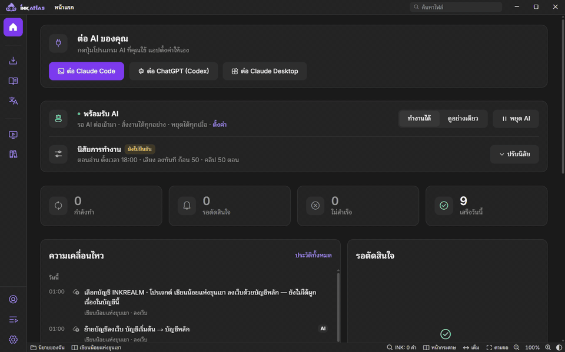
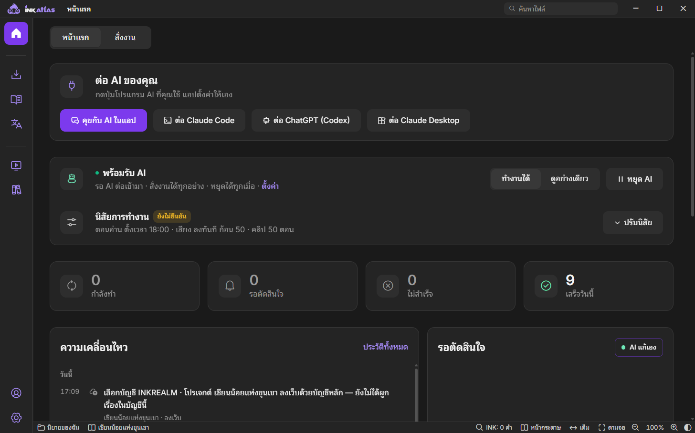
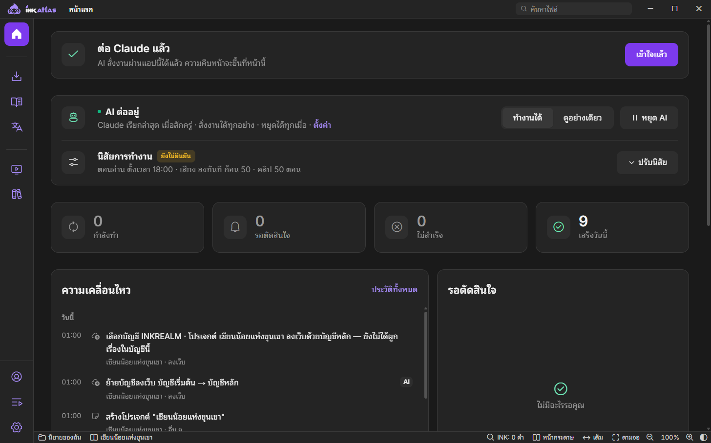
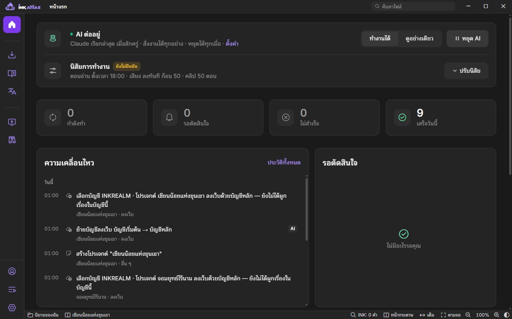
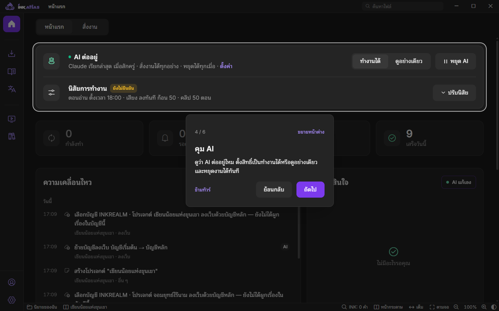
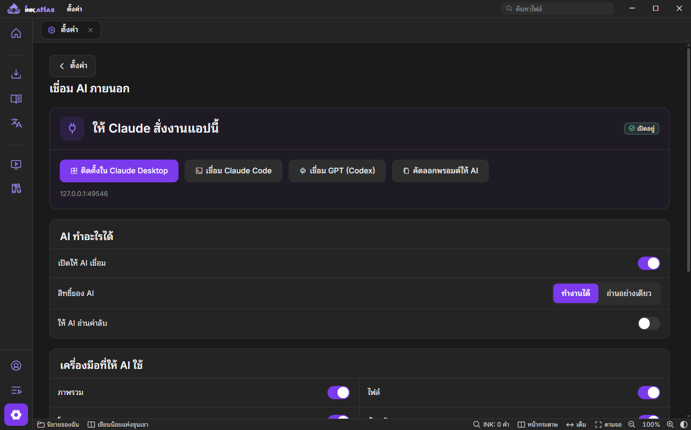

<p align="center">
  
</p>

<h1 align="center">INKATLAS</h1>

<p align="center"><b>ให้ AI ทำงานนิยายแทนคุณ — คุณแค่คอยดูและคุม</b><br>โหลด · คำศัพท์ · แปล · ตรวจ · ปก · เสียง · คลิป · ลงเว็บ ครบในแอปเดียว</p>

<p align="center">
  <a href="https://github.com/snibzyz/inkatlas-releases/releases/latest/download/INKATLAS-Setup.exe"></a>
  <a href="https://github.com/snibzyz/inkatlas-releases/releases/latest/download/INKATLAS-arm64.dmg"></a>
</p>
<p align="center">
  <a href="https://github.com/snibzyz/inkatlas-releases/releases/latest"></a>
  <a href="https://github.com/snibzyz/inkatlas-releases/releases"></a>
  
  
  
</p>
<p align="center"><sub>Windows 10 ขึ้นไป · macOS 10.15 ขึ้นไป (Apple Silicon) · ปุ่มด้านบนโหลดรุ่นล่าสุดเสมอ · <a href="https://github.com/snibzyz/inkatlas-releases/releases">ดูทุกรุ่น</a></sub></p>

<p align="center">
  
</p>

ใช้งานได้เฉพาะคีย์ที่**ได้รับสิทธิ์ ATLAS** · ติดตั้งครั้งเดียว แอปอัปเดตตัวเองให้

---

## ใช้ยังไง — 3 ขั้น

**ถามให้ AI บอกเองได้เลยว่าทำอะไรได้บ้าง** · แนะนำ Claude Code + Sonnet 5.5 · ดู **[คู่มือเริ่มต้น](GUIDE.md)**

| 1. โหลดและเปิด | 2. ต่อ AI ของคุณ | 3. สั่งงาน แล้วคอยดู |
|---|---|---|
| โหลดไฟล์ติดตั้งด้านล่าง ใส่คีย์ที่ได้รับ | หน้าแรกมีปุ่มต่อ Claude หรือ ChatGPT กดปุ่มเดียว แอปตั้งค่าให้เอง | พิมพ์สั่ง AI ในแชตของคุณ ความคืบหน้าขึ้นที่หน้าแรกของแอป |

### ต่อ AI ในกดเดียว

<p align="center">
  
</p>

กดปุ่มโปรแกรม AI ที่ใช้ (ตัวที่เครื่องมีอยู่จะขึ้นก่อน) ทำตามข้อเดียวที่แอปบอก แล้วพิมพ์ข้อความแรกในแชตของ AI
หรือกด **คุยกับ AI ในแอป** เพื่อสั่งงานผ่านแชตในหน้าต่างของแอปเอง
เมื่อ AI เรียกเข้ามาจริง แอปจะขึ้น **"ต่อ Claude แล้ว"** ให้เห็นเอง

<p align="center">
  
</p>

### เฝ้าดูและคุมงาน

<p align="center">
  
</p>

- **คุม AI** — ดูว่า AI ต่ออยู่ไหม ตั้งสิทธิ์เป็น "ทำงานได้" หรือ "ดูอย่างเดียว" และหยุดงานได้ทันที
- **ความเคลื่อนไหว** — บันทึกว่า AI ทำอะไรไปแล้ว
- **สั่งงาน** — แชตกับ AI ในแอปเลย ไม่ต้องเปิดโปรแกรมอื่น เปิดแอปทุกครั้งขึ้นแชทใหม่ เรื่องเก่าดูย้อนหลังได้
- **รอตัดสินใจ** — เฉพาะเรื่องที่ AI ตัดสินเองไม่ได้ ต้องให้คุณเคาะ กด **ให้ AI แก้** หรือเปิด **AI แก้เอง** ให้ AI แก้ปัญหาที่ค้างให้

### ทัวร์แนะนำ

เปิดแอปครั้งแรกมีทัวร์ 6 จุดชี้ให้ดูของจริงในแอป เปิดดูซ้ำได้จาก **ตั้งค่า → เกี่ยวกับ**

<p align="center">
  
</p>

### ตั้งค่าการเชื่อม AI

<p align="center">
  
</p>

เลือกได้ว่า AI ทำอะไรได้บ้าง (สิทธิ์ · เครื่องมือแต่ละกลุ่ม) และต่อกับโปรแกรมอื่นเพิ่มได้

---

## ดาวน์โหลด

โหลดรุ่นล่าสุดที่ **[หน้า Releases](https://github.com/snibzyz/inkatlas-releases/releases/latest)** แล้วเลือกไฟล์ให้ตรงกับเครื่อง

| เครื่อง | ไฟล์ | หมายเหตุ |
|---|---|---|
| Windows | [`INKATLAS-Setup.exe`](https://github.com/snibzyz/inkatlas-releases/releases/latest/download/INKATLAS-Setup.exe) | ตัวติดตั้ง (อัปเดตอัตโนมัติ) |
| macOS — Apple Silicon (M1 ขึ้นไป) | [`INKATLAS-arm64.dmg`](https://github.com/snibzyz/inkatlas-releases/releases/latest/download/INKATLAS-arm64.dmg) | |

---

## ติดตั้ง

### Windows
1. ดับเบิลคลิก `INKATLAS-Setup.exe` — ติดตั้งเสร็จแล้วแอปเปิดเอง
2. ถ้าตัวติดตั้งขึ้นว่า "cannot be closed" ให้ปิด INKATLAS ที่เปิดค้างใน Task Manager ก่อน

### macOS
1. เปิดไฟล์ `.dmg` แล้วลาก **INKATLAS** ไปที่ **Applications**
2. คลิกขวาที่แอป → **Open** (ครั้งแรกต้องเปิดแบบนี้)
3. ถ้าขึ้นว่าแอป "เสียหาย" ให้รันใน Terminal:
   ```
   xattr -cr "/Applications/INKATLAS.app"
   ```

---

## ความต้องการของระบบ

- **Windows** — Windows 10 ขึ้นไป (64-bit)
- **macOS** — macOS 10.15 ขึ้นไป · Apple Silicon
- โปรแกรม AI ที่ใช้สั่งงาน เช่น Claude Desktop, Claude Code หรือ ChatGPT Codex (ตัวใดตัวหนึ่ง)

---

© INKREALM
