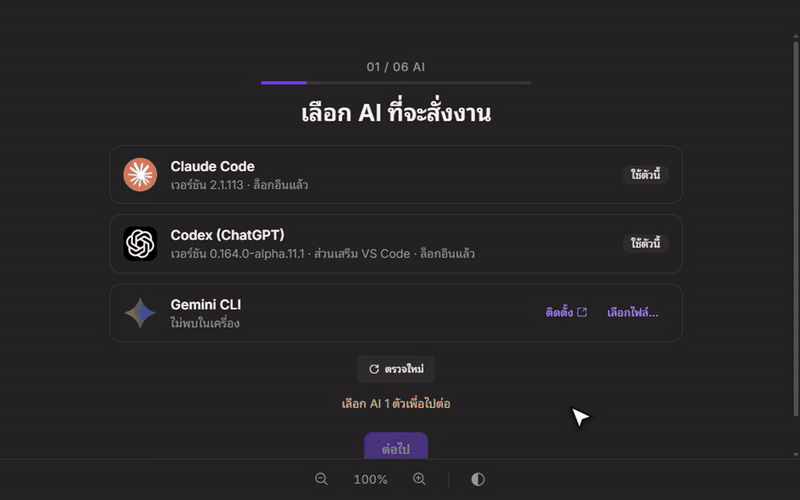
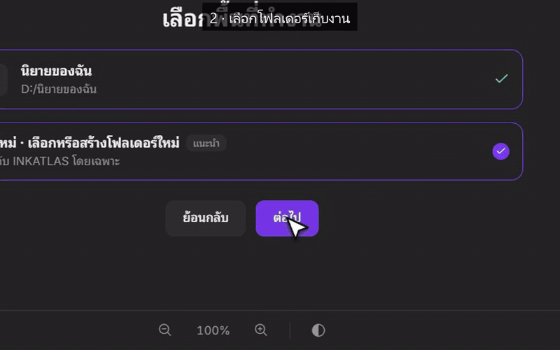
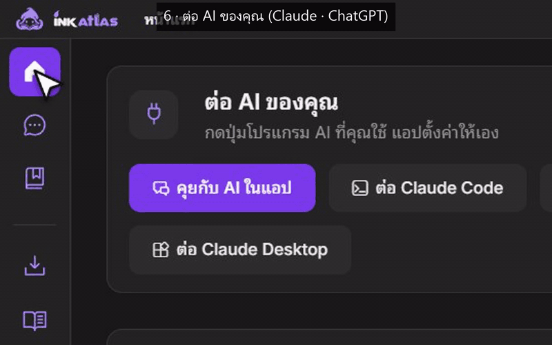

<p align="center">
  
</p>

<h1 align="center">INKATLAS</h1>

<p align="center"><b>ให้ AI ทำงานนิยายแทนคุณ — คุณแค่คอยดู</b><br>โหลด · คำศัพท์ · แปล · ตรวจ · ปก · เสียง · คลิป · ลงเว็บ ครบในแอปเดียว</p>

<p align="center">
  <a href="https://github.com/snibzyz/inkatlas-releases/releases/latest/download/INKATLAS-Setup.exe"></a>
  <a href="https://github.com/snibzyz/inkatlas-releases/releases/latest/download/INKATLAS-arm64.dmg"></a>
</p>
<p align="center">
  <a href="https://github.com/snibzyz/inkatlas-releases/releases/latest"></a>
  <a href="https://github.com/snibzyz/inkatlas-releases/releases"></a>
  
  
  
</p>
<p align="center"><sub>Windows 10 ขึ้นไป · macOS 10.15 ขึ้นไป (Apple Silicon) · ใช้ได้เฉพาะคีย์ที่ได้รับสิทธิ์ ATLAS</sub></p>

<p align="center">
  
</p>

---

## เริ่มใช้ใน 8 ขั้น

<sub>ภาพตัวอย่างใช้ข้อมูลสมมติ</sub>

### 1 · เลือก AI ที่จะสั่งงาน
เปิดแอปครั้งแรก เลือก Claude Code, ChatGPT (Codex) หรือ Gemini ที่ติดตั้งในเครื่องไว้แล้ว
<p align="center"></p>

### 2 · เลือกโฟลเดอร์เก็บงาน
ไฟล์งานทั้งหมดอยู่ในโฟลเดอร์นี้ แยกตามเรื่อง แนะนำให้เริ่มด้วยโฟลเดอร์ใหม่
<p align="center"></p>

### 3 · ใส่คีย์ (ข้ามได้)
MaxPlus ใช้แปล Webshare ใช้กระจาย IP ยังไม่มีก็ข้ามไปก่อน ใส่ทีหลังได้
<p align="center"></p>

### 4 · ตั้งค่าเร็ว
ไม่อยากตอบทีละข้อ กด **ใช้ค่าแนะนำทั้งหมด** แล้วบันทึก
<p align="center"></p>

### 5 · ตรวจความพร้อม
เห็นว่าอะไรพร้อมแล้ว อะไรยังขาด กด **เริ่มใช้งาน**
<p align="center"></p>

### 6 · ต่อ AI ของคุณ
กดปุ่มเดียว **ต่อ Claude Code · ต่อ ChatGPT (Codex) · ต่อ Claude Desktop** หรือกด **คุยกับ AI ในแอป** สั่งงานในหน้าต่างของแอปเลย
<p align="center"></p>

### 7 · สั่งเริ่มนิยายเรื่องแรก
พิมพ์ภาษาไทยธรรมดา เช่น `เริ่มแปลนิยาย 1 เรื่อง ตามนิสัยที่ตั้งไว้` AI หาเรื่อง เปิดโปรเจกต์ และเริ่มทำให้เอง
<p align="center"></p>

### 8 · ดูความคืบหน้า
หน้าแรกบอกว่า AI ทำอะไรไปแล้ว ถึงขั้นไหน และมีเรื่องไหนรอคุณตัดสินใจ
<p align="center"></p>

มีอะไรสงสัย ถาม AI ได้เลยว่า "ทำอะไรได้บ้าง" · ดู **[คู่มือเริ่มต้น](GUIDE.md)**

---

## ดาวน์โหลด

| เครื่อง | ไฟล์ |
|---|---|
| Windows | [`INKATLAS-Setup.exe`](https://github.com/snibzyz/inkatlas-releases/releases/latest/download/INKATLAS-Setup.exe) |
| macOS — Apple Silicon (M1 ขึ้นไป) | [`INKATLAS-arm64.dmg`](https://github.com/snibzyz/inkatlas-releases/releases/latest/download/INKATLAS-arm64.dmg) |

ทุกรุ่นดูได้ที่ [หน้า Releases](https://github.com/snibzyz/inkatlas-releases/releases)

## ติดตั้ง

**Windows** — ดับเบิลคลิก `INKATLAS-Setup.exe` ติดตั้งเสร็จแอปเปิดเอง · ถ้าตัวติดตั้งขึ้นว่า "cannot be closed" ให้ปิด INKATLAS ที่เปิดค้างใน Task Manager ก่อน

**macOS** — เปิดไฟล์ `.dmg` แล้วลาก **INKATLAS** ไปที่ **Applications** · คลิกขวาที่แอป → **Open** (ครั้งแรกต้องเปิดแบบนี้) · ถ้าขึ้นว่าแอป "เสียหาย" ให้รันใน Terminal:

```
xattr -cr "/Applications/INKATLAS.app"
```

---

© INKREALM
